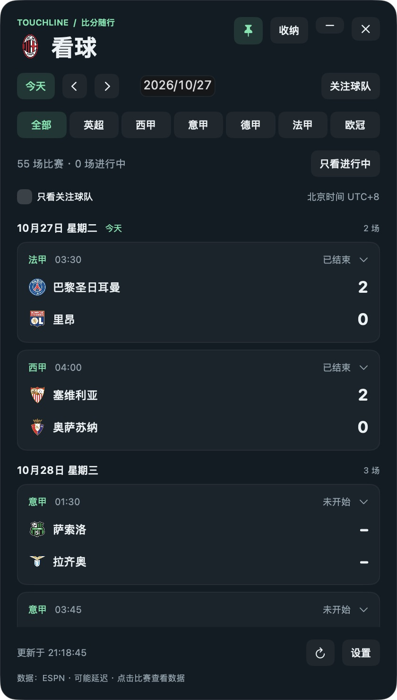

# 看球 · Touchline

Windows / macOS 桌面足球卡片，支持五大联赛和欧冠。

## 下载与运行

| 平台 | 下载 | 运行要求 |
| --- | --- | --- |
| Windows | [Windows 稳定版](https://github.com/AEGO-WRJ/touchline-desktop/releases/latest) → `Touchline.exe` | Windows 10/11 |
| macOS | [macOS 预览版](https://github.com/AEGO-WRJ/touchline-desktop/releases/tag/v1.3.1-macos.1) → `Touchline-macOS-universal.zip` | macOS 13 Ventura 或更新；Apple Silicon / Intel 通用包 |

Windows 双击 `Touchline.exe` 运行。Mac 解压后将 `Touchline.app` 拖入“应用程序”，双击打开。升级前先退出旧版，再替换应用，个人设置保存在应用之外。

Mac 预览版使用本地 ad-hoc 签名，尚未使用 Developer ID 签名或通过 Apple 公证。首次打开可能被系统拦截；确认来自本仓库后，可按 [Apple 官方说明](https://support.apple.com/zh-cn/102445)在“系统设置 → 隐私与安全性”中允许打开，也可以自行构建。

## 功能

- 按北京时间显示赛程、比分、比赛数据和进球/红黄牌事件。
- 支持关注球队、排序及只看关注，首位球队显示队徽。
- 按联赛或“只看进行中”筛选；比分变化和更正可选声音提示。
- 可拖动、置顶、收纳为小条；卡片与小条分别记忆透明度。
- 网络或数据源异常时保留本地缓存，并标注缓存和更新时间。
- Mac 队徽支持内存与磁盘缓存、失败重试、备用地址和离线回退。
- 登录自启默认关闭，可在设置中主动开启。

### macOS 使用

Mac 版使用 SwiftUI / AppKit 原生界面，无需安装 .NET、Python、Node.js 或 Rosetta（Apple Silicon 原生运行）。



- 拖动标题区域移动窗口，拖动边缘调整完整卡片大小。
- 点击日期输入框选择赛程起始日，每页显示 7 天；左右箭头切换周，“今天”回到今日赛程。
- “收纳”缩为小条，“展开”恢复原尺寸；小条圆形按钮单独调整不透明度。
- 默认启动后仅驻留顶部菜单栏，不占用 Dock；点击足球或首位关注球队的队徽 →“显示卡片”打开窗口。设置中的“启动时仅显示菜单栏图标”可关闭，使下次启动直接显示卡片。
- `−`、`×` 和 `⌘W` 均隐藏卡片，应用保留在菜单栏，暂停比分刷新；完全退出请使用菜单栏中的“退出看球”或 `⌘Q`。
- 顶部图标使用首位关注球队的队徽，未关注时显示足球。完整卡片显示且有进行中的比赛时，旁边显示场数；暂停刷新后隐藏场数，避免把旧比分当作实时数据。统计遵循卡片当前赛程范围和筛选条件。
- 菜单栏可直接展开/收纳、切换置顶、管理关注球队、刷新比分与队徽、修改启动方式和打开设置。
- 应用激活时，`⌘1` 显示卡片、`⌘R` 刷新、`⌘,` 打开设置、`⌘Q` 退出。
- 先把应用放到固定位置，再开启“登录 Mac 时自动启动”。若系统要求批准，进入“系统设置 → 通用 → 登录项”允许；移动应用后请关闭再开启自启。

Mac 版支持跨桌面显示；全屏应用与台前调度中的层级仍受 macOS 管理。后台运行与登录自启是两个独立设置，登录自启仍默认关闭。Mac 睡眠期间不刷新，唤醒后重新同步。

### Mac 比分更新时机

- 只有完整卡片展开并显示时才请求赛程与比分：已加载比赛中有进行中的比赛时每 30 秒刷新，其余每 2 分钟刷新。
- 收纳为小条、隐藏到菜单栏或隐藏应用时立即暂停，并取消尚未完成的赛程请求。
- 重新展开完整卡片时立即同步，再恢复定时刷新。睡眠唤醒后也遵循这一显示条件。
- 菜单栏的“打开卡片并刷新”会先展开完整卡片，再进行手动刷新。队徽缓存与比分请求相互独立，菜单栏仍可读取本地队徽或按需补全缺失队徽。

### Mac 队徽加载

1. 优先使用赛程接口的队徽地址，失败后尝试内置球队目录和按球队 ID 生成的 ESPN 地址；仅接受 ESPN 图片域名的 HTTPS 地址。
2. 先读取内存或磁盘缓存，有效期 30 天。过期队徽先显示旧图并尝试更新；断网、服务异常时继续使用旧图。未缓存过的队徽无法离线显示，此时使用足球占位图。
3. 下载失败后等待 1.5 秒重试一次；连续失败后短暂冷却，避免反复重绘时重复请求。正常比分刷新时会重新检查缺失队徽；手动刷新可清除失败冷却。
4. 卡片、关注列表、收纳条和菜单栏共用缓存，相同地址的并发请求只下载一次，最多同时下载 6 张。验证图片后缩为最长边 128 像素，并原子写入缓存；无效图片不会覆盖旧图。

缓存保存在本机，重启应用后可以继续使用；macOS 清理系统缓存后会按需重新下载。

## 本地数据

| 平台 | 位置 |
| --- | --- |
| Windows 配置和缓存 | `%LOCALAPPDATA%\TouchlineCard` |
| macOS 配置和备份 | `~/Library/Application Support/TouchlineCard/settings.json`、`settings.json.bak` |
| macOS 赛程缓存 | `~/Library/Caches/TouchlineCard` |
| macOS 队徽缓存 | `~/Library/Caches/TouchlineCard/badges` |

关注列表、排序、筛选和窗口状态保存在本机；两个平台的设置不会自动同步。Windows 开启自启后请保持程序位置固定，移动后重新运行一次即可更新路径。

## 构建

### Windows

在 Windows PowerShell 执行：

```powershell
./build.ps1
```

生成 `dist/Touchline.exe`，使用系统自带 .NET Framework 编译器，无需额外开发依赖。

### macOS

需要 macOS 和 Apple Xcode Command Line Tools（可用 `xcode-select --install` 安装），在仓库根目录执行：

```sh
./build-macos.sh            # 默认构建 Apple Silicon + Intel 通用版
./build-macos.sh arm64      # 仅 Apple Silicon
./build-macos.sh x86_64     # 仅 Intel
```

生成 `dist/Touchline.app` 和 `dist/Touchline-macOS-<架构>.zip`。无需下载第三方依赖。脚本优先使用独立 Command Line Tools；也支持通过 `DEVELOPER_DIR`、`SDKROOT` 指定开发工具和 SDK。

默认采用 ad-hoc 签名。开发者可设置 `SIGN_IDENTITY` 使用自己的 Developer ID 证书签名；公证和 stapling 需另行完成，构建脚本不会申请证书或代办公证。

### 验证

```sh
./test-macos.sh
```

57 项自动检查覆盖北京时间边界、ESPN 多种时间与比分格式、去重和筛选、比分变化、设置备份恢复、网络失败和异常响应的赛程缓存回退，以及队徽缓存跨实例复用、30 天过期、离线回退、重试、备用地址、请求合并、并发上限、损坏图片修复和后台启动偏好。测试使用隔离临时目录和模拟网络，不修改个人设置、不依赖在线赛程。

macOS 版已在 Apple Silicon 上完成编译、启动和实际 ESPN 数据界面检查。Intel 已完成交叉编译，尚未实机运行验证；登录自启仍需在用户允许后验证。Windows 源码和构建方式保持原样，本次未在 Windows 上重新运行验证。

开发时可通过 `TOUCHLINE_DATA_DIR` 为应用指定隔离设置目录，比赛缓存也会放到该目录下，便于测试而不影响个人配置。

## 源码

- `src/`：Windows C# / WPF 源码。
- `macos/Sources/`：macOS SwiftUI / AppKit 源码。
- `macos/Tests/`：macOS 数据与持久化测试。
- `assets/`：图标、共享球队目录和 Mac 使用的中文名称表；中文名称与 `src/Names.cs` 保持一致。

## 数据来源

数据来自 [ESPN](https://www.espn.com/soccer/scoreboard)，赛中每 30 秒、其余每 2 分钟检查；Mac 版仅在完整卡片显示时启用该定时更新。较远日期使用短期缓存，手动刷新会重新请求。数据可能延迟、缺失或被修正。本项目与 ESPN 无隶属关系。
